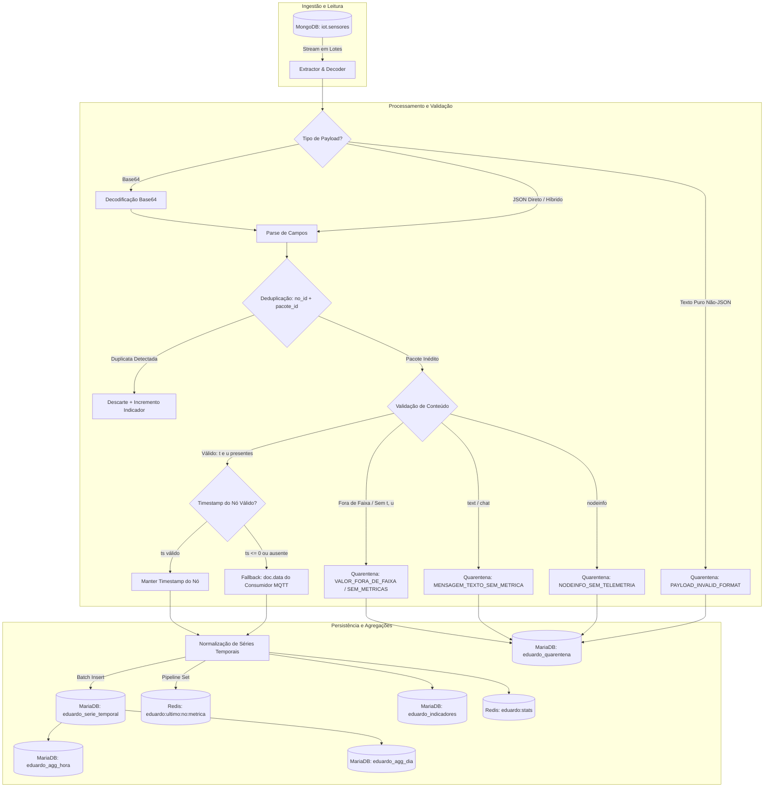

# Atividade 10 — Pipeline e Modelagem de Dados IoT

Pipeline resiliente de ingestão, validação, deduplicação, agregação e modelagem analítica de telemetria de sensores IoT (redes Mesh LoRa/Meshtastic e Serial), integrando **MongoDB**, **MariaDB** e **Redis**.

---

## 🏛️ 1. Arquitetura do Pipeline



---

## 📋 2. Requisitos Atendidos e Evidências

| Requisito | Descrição | Status | Evidência Comprovada |
| :--- | :--- | :---: | :--- |
| **1. MongoDB** | Ler dados brutos da coleção `sensores` e mapear formatos. | Concluído | Leitura em stream dos 2.807 documentos reais mapeando os 4 formatos estruturais. |
| **2. Processamento** | Decodificar, normalizar e validar dados conforme o tipo. | Concluído | Suporte a JSON direto, `payload_data`, Base64 e mensagens seriais. Extração padronizada de `t` e `u`. |
| **3. Deduplicação** | Identificar mensagens repetidas por `(no_id, pacote_id)`. | Concluído | **1.834 duplicatas** detectadas e isoladas com base no identificador do rádio e do pacote. |
| **4. Timestamps** | Detectar timestamps inválidos e usar fallback de recebimento. | Concluído | **10 timestamps zero/ausentes** corrigidos utilizando o campo `data` gravado pelo consumidor MQTT. |
| **5. MariaDB** | Armazenar séries temporais válidas e gerar agregações horárias e diárias. | Concluído | **1.796 medições** persistidas em `eduardo_serie_temporal` com tabelas `eduardo_agg_hora` e `eduardo_agg_dia`. |
| **6. Redis** | Armazenar o último valor válido de cada nó. | Concluído | Chaves `eduardo:ultimo:<no_id>:<metrica>` atualizadas com JSON contendo valor, timestamp e id do pacote. |
| **7. Quarentena** | Armazenar mensagens rejeitadas registrando o motivo. | Concluído | **75 mensagens** rejeitadas e auditadas em `eduardo_quarentena` (nenhum descarte silencioso). |
| **8. Indicadores** | Contabilizar processadas, duplicadas, rejeitadas e fallbacks. | Concluído | Contadores sincronizados no MariaDB (`eduardo_indicadores`) e no Redis (`eduardo:stats`). |
| **9. Consultas** | Criar pelo menos três consultas úteis demonstrando os dados. | Concluído | Script `npm run queries` executando 3 consultas analíticas + resumo de indicadores. |
| **12. Documentação**| README detalhado com arquitetura, setup, execução e evidências. | Concluído | Este documento. |

---

## ⚙️ 3. Configuração do Ambiente

O projeto gerencia conexões e credenciais de forma segura através de variáveis de ambiente.

### Suporte ao `.env`

O leitor de configurações (`src/config.js`) é inteligente e suporta:
1. Formato padrão `CHAVE=VALOR`.
2. Formato tabular (como fornecido no ambiente educacional).

As variáveis principais são:

```env
# Configurações do MariaDB
MARIADB_HOST=35.226.64.52
MARIADB_PORT=3306
MARIADB_USER=fatec_app
MARIADB_PASSWORD=******
MARIADB_DATABASE=fatec_iot
TABLE_PREFIX=eduardo_

# Configurações do MongoDB
MONGODB_HOST=35.226.64.52
MONGODB_PORT=27017
MONGODB_USER=root
MONGODB_PASSWORD=******
MONGODB_DATABASE=iot
MONGODB_COLLECTION=sensores

# Configurações do Redis
REDIS_HOST=35.226.64.52
REDIS_PORT=6379
REDIS_PASSWORD=******
REDIS_PREFIX=eduardo:
```

> [!NOTE]
> Para evitar conflito entre os alunos no banco compartilhado `fatec_iot`, todas as tabelas e chaves utilizam o prefixo configurável `eduardo_` (MariaDB) e `eduardo:` (Redis).

---

## 🚀 4. Instruções de Instalação e Execução

### Pré-requisitos
* Node.js `>= 18.0.0` (testado no Node.js v21.7.3)
* npm `>= 9.0.0`

### Instalação de Dependências

```bash
npm install
```

### Executar o Pipeline Completo

Processa todos os documentos do MongoDB, deduplica, valida, aplica fallback de timestamps, popula MariaDB, agregações e Redis:

```bash
npm start
```

### Executar a Suíte de Testes Automatizados

Executa os 11 testes cobrindo dados válidos, duplicatas, mensagens de quarentena, fallback de timestamps e falhas de conexão:

```bash
npm test
```

### Executar as Consultas Analíticas

Executa e exibe no terminal as 3 consultas SQL analíticas e os indicadores persistidos:

```bash
npm run queries
```

---

## 📊 5. Resultados e Evidências da Execução Real

Execução realizada sobre a coleção real `sensores` do MongoDB:

```text
=====================================================
📊 INDICADORES FINAIS DO PIPELINE (CONCLUÍDO)
=====================================================
⏱️ Tempo total de execução: 21.98s
📥 Total de documentos lidos do MongoDB: 2.807
🔁 Duplicatas detectadas e descartadas:  1.834
🚫 Mensagens rejeitadas (Quarentena):    75
⏰ Timestamps inválidos c/ fallback:    10
📈 Séries temporais válidas persistidas: 1.796

📋 Motivos de Envio para Quarentena:
   - MENSAGEM_TEXTO_SEM_METRICA: 55  (mensagens de chat/teste como "teste", "teste2")
   - NODEINFO_SEM_TELEMETRIA:    19  (dados de hardware e configuração do rádio)
   - PAYLOAD_INVALID_FORMAT:     1   (string de texto puro não-JSON de ping do cliente)
=====================================================
```

---

## 🔍 6. Consultas Analíticas Demonstrativas

### Consulta 1: Últimas Leituras Válidas da Série Temporal
Demonstra as leituras processadas, valor medido, instante real da medição e se o fallback para a data do consumidor MQTT (`doc.data`) foi necessário.

```sql
SELECT
  no_id,
  pacote_id,
  metrica,
  valor,
  timestamp_medicao,
  CASE WHEN timestamp_fallback = 1 THEN 'SIM (Doc.Data)' ELSE 'NÃO (Nó)' END AS fallback_aplicado,
  recebido_em
FROM eduardo_serie_temporal
ORDER BY timestamp_medicao DESC
LIMIT 10;
```

**Resultado Real Obtido:**
| no_id | pacote_id | metrica | valor | timestamp_medicao | fallback_aplicado | recebido_em |
| :--- | :--- | :--- | :---: | :--- | :---: | :--- |
| `!8fa724e8` | 263253573 | temperatura | 23.0 | 2026-10-24 17:21:40.000 | NÃO (Nó) | 2026-10-24 17:21:42.774 |
| `!8fa724e8` | 263253573 | umidade | 14.0 | 2026-10-24 17:21:40.000 | NÃO (Nó) | 2026-10-24 17:21:42.774 |
| `!8fa724e8` | 1183188001 | temperatura | 23.0 | 2026-10-24 17:03:33.000 | NÃO (Nó) | 2026-10-24 17:03:34.798 |
| `!8fa724e8` | 1183188001 | umidade | 14.0 | 2026-10-24 17:03:33.000 | NÃO (Nó) | 2026-10-24 17:03:34.798 |

---

### Consulta 2: Agregação Estatística Diária Pré-Computada
Comprova a modelagem de agregação diária com médias, valores mínimos, máximos e volume de leituras por nó.

```sql
SELECT
  no_id,
  metrica,
  janela_dia,
  media_valor,
  min_valor,
  max_valor,
  contagem_leituras
FROM eduardo_agg_dia
ORDER BY janela_dia DESC, no_id, metrica;
```

**Resultado Real Obtido:**
| no_id | metrica | janela_dia | media_valor | min_valor | max_valor | contagem_leituras |
| :--- | :--- | :---: | :---: | :---: | :---: | :---: |
| `!8fa724e8` | temperatura | 2026-10-24 | **20.40°C** | 19.0°C | 24.0°C | 208 |
| `!8fa724e8` | umidade | 2026-10-24 | **15.68%** | 14.0% | 17.0% | 208 |
| `!8fa724e8` | temperatura | 2026-10-23 | **20.58°C** | 19.0°C | 23.0°C | 255 |
| `!8fa724e8` | umidade | 2026-10-23 | **15.56%** | 15.0% | 17.0% | 255 |
| `serial:COM8`| temperatura | 2026-10-23 | **20.00°C** | 20.0°C | 20.0°C | 5 |
| `serial:COM8`| umidade | 2026-10-23 | **16.00%** | 16.0% | 16.0% | 5 |
| `!8fa724e8` | temperatura | 2026-10-22 | **22.27°C** | 22.0°C | 27.0°C | 430 |
| `!8fa724e8` | umidade | 2026-10-22 | **14.95%** | 14.0% | 16.0% | 430 |

---

### Consulta 3: Auditoria da Quarentena por Motivo
Evidencia que nenhuma mensagem foi descartada silenciosamente. Todas as rejeições estão registradas com tipo, contagem e período.

```sql
SELECT
  motivo_rejeicao,
  tipo_mensagem,
  COUNT(*) AS total_mensagens,
  MIN(recebido_em) AS primeiro_registro,
  MAX(recebido_em) AS ultimo_registro
FROM eduardo_quarentena
GROUP BY motivo_rejeicao, tipo_mensagem
ORDER BY total_mensagens DESC;
```

**Resultado Real Obtido:**
| motivo_rejeicao | tipo_mensagem | total_mensagens | primeiro_registro | ultimo_registro |
| :--- | :--- | :---: | :--- | :--- |
| `MENSAGEM_TEXTO_SEM_METRICA` | text | 55 | 2026-10-19 18:23:02.009 | 2026-10-26 12:22:57.989 |
| `NODEINFO_SEM_TELEMETRIA` | nodeinfo | 19 | 2026-10-19 18:13:18.998 | 2026-10-26 12:03:30.373 |
| `PAYLOAD_INVALID_FORMAT` | invalido | 1 | 2026-10-22 13:27:52.866 | 2026-10-22 13:27:52.866 |

---

## 🧪 7. Resultados dos Testes Automatizados

Execução via `npm test`:

```text
▶ 1. Testes de Extração e Normalização
  ✔ Deve decodificar payload híbrido (payload_data)
  ✔ Deve decodificar payload_base64 corretamente
  ✔ Deve rejeitar payload de texto puro inválido para JSON
▶ 2. Testes de Validação e Regras de Negócio
  ✔ Deve aceitar medições válidas de temperatura e umidade
  ✔ Deve acionar fallback para timestamp inválido (timestamp = 0)
  ✔ Deve rejeitar mensagens de texto (chat/teste) para quarentena
  ✔ Deve rejeitar mensagem nodeinfo para quarentena
  ✔ Deve rejeitar valores fora de limites físicos (temperatura > 85°C)
▶ 3. Testes de Deduplicação
  ✔ Deve detectar pacotes repetidos pelo par (noId, pacoteId)
▶ 4. Testes de Falhas de Conexão e Resiliência
  ✔ Deve capturar erro ao tentar conectar em host Mongo inacessível
  ✔ Deve capturar erro ao tentar conectar em host Redis inacessível

ℹ tests 11 | pass 11 | fail 0 (100% de aprovação)
```

---

## 🗂️ 8. Estrutura de Arquivos do Projeto

```text
pipeline-pi-6-termo/
├── .env                          # Credenciais e endpoints dos serviços (gitignored)
├── .gitignore                    # Regras de exclusão de arquivos sensíveis
├── package.json                  # Dependências e scripts de execução
├── README.md                     # Documentação completa e evidências
├── index.js                      # Ponto de entrada do pipeline
├── src/
│   ├── config.js                 # Carregador de configurações multi-formato
│   ├── database/
│   │   ├── mongodb.js            # Ingestão e streaming do MongoDB
│   │   ├── mariadb.js            # DDL, série temporal, agregações e quarentena
│   │   └── redis.js              # Armazenamento de estado atual e contadores
│   ├── pipeline/
│   │   ├── extractor.js          # Decodificador de múltiplos formatos (JSON, B64, Serial)
│   │   ├── validator.js          # Validações de limites e fallback de data
│   │   ├── deduplicator.js       # Controle e detecção de duplicatas (no + id)
│   │   └── processor.js          # Orquestrador do fluxo em lote
│   └── queries/
│       └── analyticalQueries.js  # Consultas SQL analíticas para demonstração
└── tests/
    └── pipeline.test.js          # Suíte de 11 testes automatizados
```
